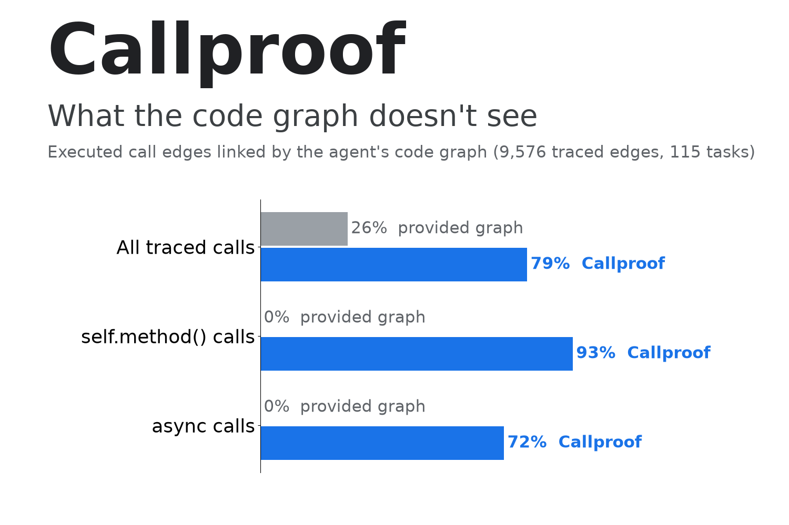

# Callproof

Test-execution traces as ground truth for the code graphs coding agents navigate: an audit of the Gemma 4 Developer Agent graphs, an open builder in the same schema that links 79% of traced calls instead of 26%, and the CallproofLP link-prediction benchmark.



Paper: {{writeup_url}} (PDF: [docs/callproof.pdf](docs/callproof.pdf)). Kaggle notebook: {{notebook_url}}.

## Headline numbers

Ground truth comes from running each task's fail-to-pass tests on the gold-patched repository and recording every call edge between repository functions (9,576 traced call edges over 115 tasks). Full tables are in [`results/audit/STATIC.md`](results/audit/STATIC.md).

| traced call edges found, with the right direction | provided graphs | Callproof |
|---|---|---|
| all calls | 25.9% | 79.3% |
| `self.method()` calls | 0% | 92.8% |
| calls into `async def` code | 0% | 72.4% |

Other findings from the audit:

- Every provided edge is stored in both directions, so the graph does not say who calls whom.
- 72% of the provided `calls` pairs are not calls (they are containment, inheritance or instantiation).
- No `async def` function and no module has a node in the provided graphs.
- Walking 3 hops from the failing test, undirected Callproof graphs reach more edited functions than the provided graphs (55.7% vs 31.3%, macro over 33 tasks) but read more nodes to do it. Following only outgoing `calls` edges matches two provided hops (25.4% vs 25.0%) while reading 36 nodes instead of 113 ([`results/audit/EXTRA.md`](results/audit/EXTRA.md)).

## CallproofLP benchmark

7,362 traced caller to callee pairs over 105 commits, in provided node ids, with a repository split (train rich, requests, httpx; test fastapi) and a commit split. The hard subset holds test pairs the provided graph does not link. Labels and the data card are in [`results/linkpred/`](results/linkpred/README.md).

| Macro MRR, hard subset | Repo split | Commit split |
|---|---|---|
| Provided adjacency | .008 | .003 |
| GraphSAGE on provided graph + embeddings | .013 | .067 |
| LightGBM, 9 pair features | .388 | **.636** |
| Callproof static `calls` (no training) | **.450** | .532 |

Full tables, including logistic regression and GraphSAGE with pair features: [`results/linkpred/RESULTS.md`](results/linkpred/RESULTS.md).

A negative result is reported too: plain BM25 and PageRank localization do not improve with the better graph ([`results/loc/baselines_eval.txt`](results/loc/baselines_eval.txt)).

## What it does

- Records dynamic call edges with a `sys.monitoring` tracer while the fail-to-pass tests of a task run, and extracts the functions the gold patch edits (`callproof/trace.py`, `callproof/patch.py`).
- Audits the provided graphs against those edges and against the source text: missing nodes, id collisions, edge direction, edge semantics, embedding coverage (`scripts/audit_static.py`).
- Builds a graph in the competition's schema for any Python checkout with a static analyser: every module, class and function (including async and nested ones), directed `calls`, `inherits`, `imports`, `references` and `decorated_by` edges, in the competition's node-link JSON schema (`python -m callproof.build`).
- Ships a small localization harness that runs Gemma 4 E2B/E4B through `llama.cpp` with the competition's three graph tools, on either graph, and scores the answers (`scripts/run_localize.py`, `callproof/localize_eval.py`).

## Try it

Needs Python 3.11 or newer.

```bash
git clone {{repo_url}} callproof && cd callproof
uv venv && uv pip install -e ".[test]"

python -m callproof.build path/to/your/checkout graph.json --repo-name myrepo_demo
```

Load the graph with the same tools the harness gives an agent:

```python
from pathlib import Path
from callproof.tools import CodeGraph

graph = CodeGraph(Path("graph.json"), None, "myrepo_demo")
print(graph.get_code_neighbors("mypackage.module.Class.method"))
print(graph.get_code_subgraph(["mypackage.module.Class.method", "mypackage.module.helper"]))
```

A typical checkout builds in a few seconds.

## How it works

The provided graphs are static and were never compared with what code does at run time, so Callproof starts from execution. For each of the 129 tasks it builds a Python 3.13 environment from the competition wheels, applies the test patch, runs the fail-to-pass tests with the gold patch applied, and keeps the caller to callee pairs that stay inside the repository. Gold-edited functions come from mapping patch hunks to the enclosing definitions at the base commit. The audit then asks, for each traced edge, whether the provided graph links the two functions in the right direction, and does the same for graphs from the new builder. The builder is a two-pass AST resolver (index every definition, then resolve call sites): it tracks imports and re-exports, the class hierarchy (so `self.method()` resolves along the MRO), instance types it can infer from constructors and annotations, decorators, properties and async calls, and it writes ids as `module.dotted.qualname` with one edge per direction of meaning.

## Reproduce

Run everything from the repository root. Developed on Linux. The ground-truth step is the slow one; scale `--jobs` to your core count.

1. Get the competition data (accept the competition rules on Kaggle first):

   ```bash
   uv pip install kagglehub
   python -c "import kagglehub; print(kagglehub.competition_download('gemma-4-developer-agent'))"
   ```

   The scripts read the data from `--data` / `--data-dir`, else `$CALLPROOF_DATA`, else `~/.cache/kagglehub/competitions/gemma-4-developer-agent`. Scratch checkouts and virtualenvs go to `$CALLPROOF_CACHE` (default `~/.cache/callproof`).

2. Install, and run the tests:

   ```bash
   uv venv && uv pip install -e ".[test,dense]"
   python -m pytest tests
   ```

3. Trace ground truth (needs `uv`, `git`, `patch`, network access to PyPI for `requirements-test.txt`; without it, the script falls back to the competition wheels, which lack a few test-only packages):

   ```bash
   python scripts/groundtruth.py --tasks all --jobs 12 --out results/groundtruth
   ```

   Pass task ids to `--tasks` to check a few. Output is one JSON file per task plus `summary.csv`.

4. Audit and build the graphs for all 127 base commits (graphs go to `results/graphs`, report to `results/audit/STATIC.md`):

   ```bash
   python scripts/audit_static.py --jobs 12
   ```

5. Retrieval baselines and their scores:

   ```bash
   python -m callproof.retrieve --method bm25 --exclude-tests --run-name base_bm25_provided_notests
   python -m callproof.retrieve --method ppr  --exclude-tests --run-name base_ppr_provided_notests
   python -m callproof.retrieve --method ppr  --exclude-tests --graph results/graphs --run-name ppr_callproof_notests
   python -m callproof.localize_eval results/loc/base_bm25_provided_notests results/loc/ppr_callproof_notests
   ```

6. CallproofLP labels and baselines (needs steps 3 and 4; the learned baselines need `uv pip install lightgbm torch`):

   ```bash
   python scripts/linkpred.py build && python scripts/linkpred.py eval
   python scripts/linkpred_learned.py
   ```

7. Agent runs with Gemma 4 on CPU. Build [llama.cpp](https://github.com/ggml-org/llama.cpp) and download the Gemma 4 E4B `q4_0` GGUF (`gemma-4-E4B_q4_0-it.gguf`) into `~/.cache/callproof/models` (or set `CALLPROOF_MODELS`; the E2B file is `gemma-4-E2B_q4_0-it.gguf`). Point `LLAMA_SERVER` at the `llama-server` binary if it is not on `PATH`:

   ```bash
   IDS=$(cat results/loc/agent_subset_gold.txt)
   COMMON="--model e4b --tools walk --budget 10 --anchors 5 --temperature 0 --seed 0 --servers 2 --threads-per-server 6 --ids $IDS"
   python scripts/run_localize.py --run-name e9d_provided --graph provided $COMMON
   python scripts/run_localize.py --run-name e9d_callproof_typed --graph results/graphs --typed-neighbors --port 18500 $COMMON
   python scripts/agent_paired.py results/loc/e9d_provided results/loc/e9d_callproof_typed
   ```

   Runs resume: rerunning a command skips tasks already in `episodes.jsonl`. With temperature 0 and a fixed seed, runs repeat closely but not bit for bit across machines.

Limits: the tracer covers the fail-to-pass tests only, so recall is measured on code those tests reach, not on the whole repository. Tasks whose tests fail at both commits or cannot be installed have no ground truth (14 of 129 here).

## Repository layout

```
callproof/          package
  build.py            static graph builder (python -m callproof.build)
  trace.py            sys.monitoring call tracer, pytest plugin
  outcomes.py         pytest plugin that records per-test outcomes
  patch.py            diff parsing, gold-function extraction
  sandbox.py          offline environments from the competition wheels
  audit.py            graph versus trace and source-text checks
  graphio.py          graph loading and saving
  naming.py           node id convention
  tools.py            the harness graph tools and repo tools
  dataset.py, paths.py  access to the competition data
  retrieve.py         BM25, dense and PageRank baselines
  agent.py            llama-server client and the localization agent loop
  localize_eval.py    scoring of localization runs
scripts/            groundtruth.py, audit_static.py, linkpred.py, linkpred_learned.py, run_localize.py, agent_paired.py
tests/              unit tests
results/            per-task ground truth, audit tables, CallproofLP labels and baselines, localization scores
docs/               figures and the paper as PDF
requirements-test.txt  pinned extra packages for the traced test suites
```

## Built with

Python, `networkx`, `numpy`, `uv`, `pytest`, LightGBM and PyTorch for the learned baselines, `llama.cpp`, and Gemma 4 E2B and E4B for the localization runs. Data and wheels are from the Gemma 4 Developer Agent competition on Kaggle.

## License

Apache-2.0, see `LICENSE`.
